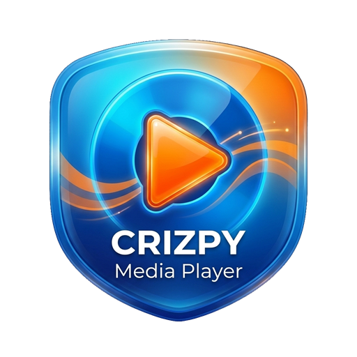

<div align="center">
  
  <h1>🎵 CriZpy Media Player</h1>
  <p><strong>Reproductor Web estilo Windows Media Player XP (Frutiger Aero)</strong> para controlar en tiempo real el bot de música <a href="https://github.com/TioCriZpy/radio-crizpy-bot">Radio CriZpy</a> en Discord.</p>
</div>

---

## ✨ Características

- **Estética Windows XP Luna / WMP 9–10:**
  - Pantalla de inicio de sesión estilo **Windows XP**, barra de título azul clásica, modales nativos XP y tema **Clásico / Oscuro** con persistencia en `localStorage`.
  - **Modo Mini-Player** compacto desde la barra de título o el menú superior.
  - Diseño **Responsive** para móvil con pestañas dedicadas (`Buscar / Playlists` y `Cola`).
- **Visualizador Canvas 2D + Controles Multimedia:**
  - Múltiples visualizadores animados en HTML5 Canvas (`Túnel Hipnótico`, `Barras`, `Carátula`, etc.) con ahorro automático de CPU/GPU cuando la pestaña está en segundo plano.
  - Integración con `navigator.mediaSession` y audio silencioso (`public/silence.wav`) para usar las teclas multimedia físicas del teclado / controles del teléfono.
  - Instalable como **PWA** (`manifest.json` + Service Worker `sw.js`).
- **Gestión Completa de Música y Playlists:**
  - Búsqueda instantánea con debounce (`420ms`) y caché en memoria.
  - Cola interactiva con drag/reordenamiento, **Sonar siguiente** (`play_next`), **Limpiar cola** y **Guardar cola como Playlist**.
  - Importación directa de **Playlists y Mixes de YouTube**, renombrado, carga normal o mezclada (`shuffle`).
  - Historial de 7 días y ventana **Archivo** con registro de movimientos de las últimas **48 horas** filtrable por origen (`Web`, `Discord`, `Automático`).
- **Sincronización WebSocket en Tiempo Real:**
  - Login vía **Discord OAuth2** con detección automática del servidor y canal de voz donde está conectado el usuario.
  - Toasts en vivo cuando alguien usa los botones del bot directamente desde Discord.

---

## 🛠️ Stack Tecnológico

- **Frontend:** React 19, Vite 8, CSS3 (variables de tema XP Luna / Dark)
- **Tiempo Real:** WebSockets nativos + Fetch API
- **Backend compatible:** [`radio-crizpy-bot`](https://github.com/TioCriZpy/radio-crizpy-bot) (Red-DiscordBot + FastAPI + Lavalink)

---

## 🚀 Instalación y Uso Local

1. **Clona el repositorio:**
   ```bash
   git clone https://github.com/TioCriZpy/crizpy-media-player.git
   cd crizpy-media-player
   ```

2. **Instala dependencias:**
   ```bash
   npm install
   ```

3. **Configura variables de entorno:**
   ```bash
   cp .env.example .env
   ```
   Edita `.env` con tu API Key (la misma configurada en el cog `web_controller` mediante `!wc setkey`) y la URL de tu backend:
   ```env
   VITE_API_KEY=tu_api_key_aqui
   VITE_API_TARGET=http://localhost:8710
   VITE_ALLOWED_HOSTS=localhost,127.0.0.1
   ```

4. **Inicia en modo desarrollo o compila para producción:**
   ```bash
   # Desarrollo
   npm run dev -- --host

   # Producción
   npm run build
   npm run preview -- --host
   ```

---

## 📄 Licencia

Distribuido bajo licencia **MIT**. Consulta [LICENSE](LICENSE) para más información.
